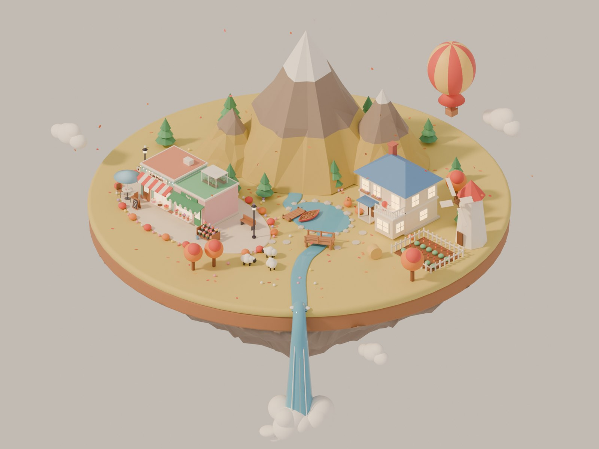
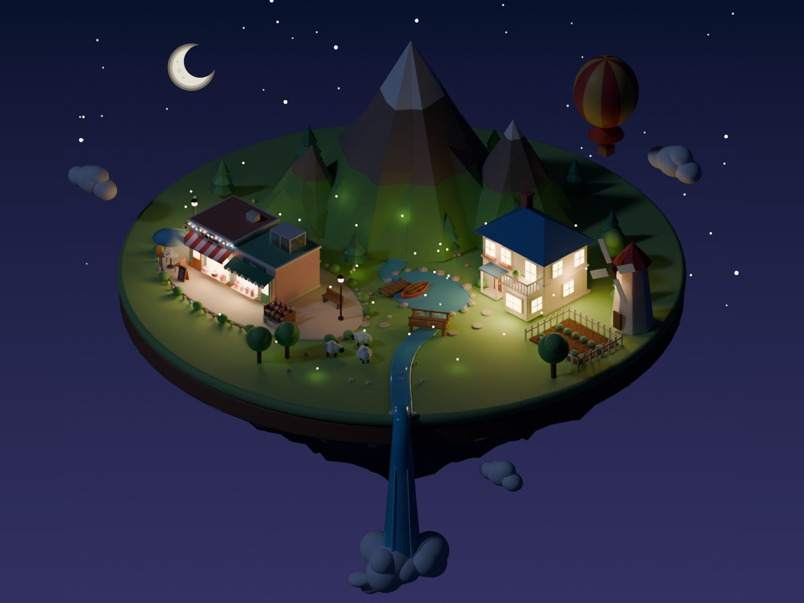
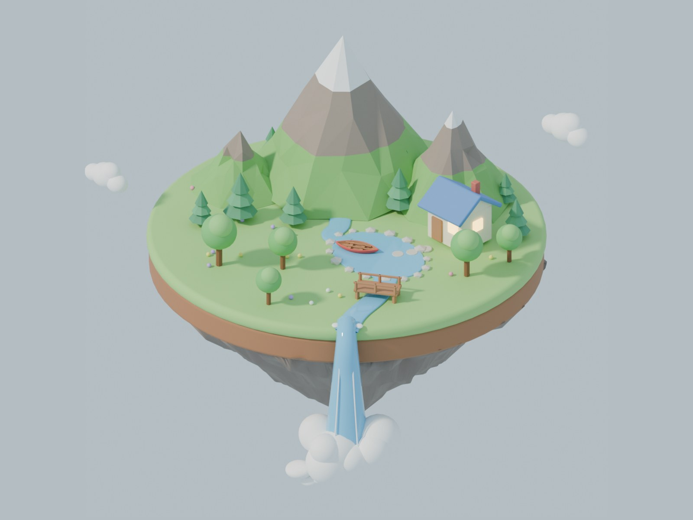
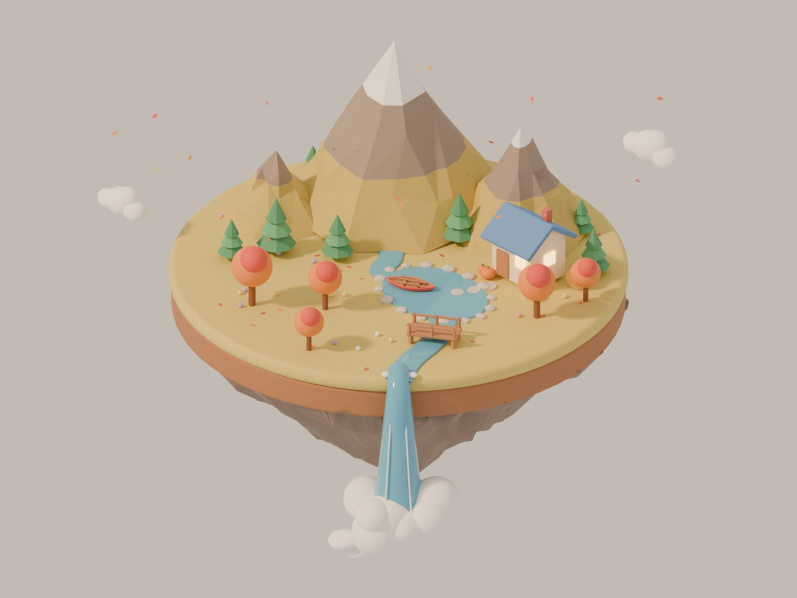
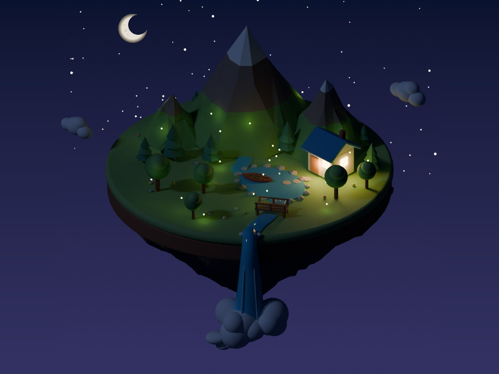
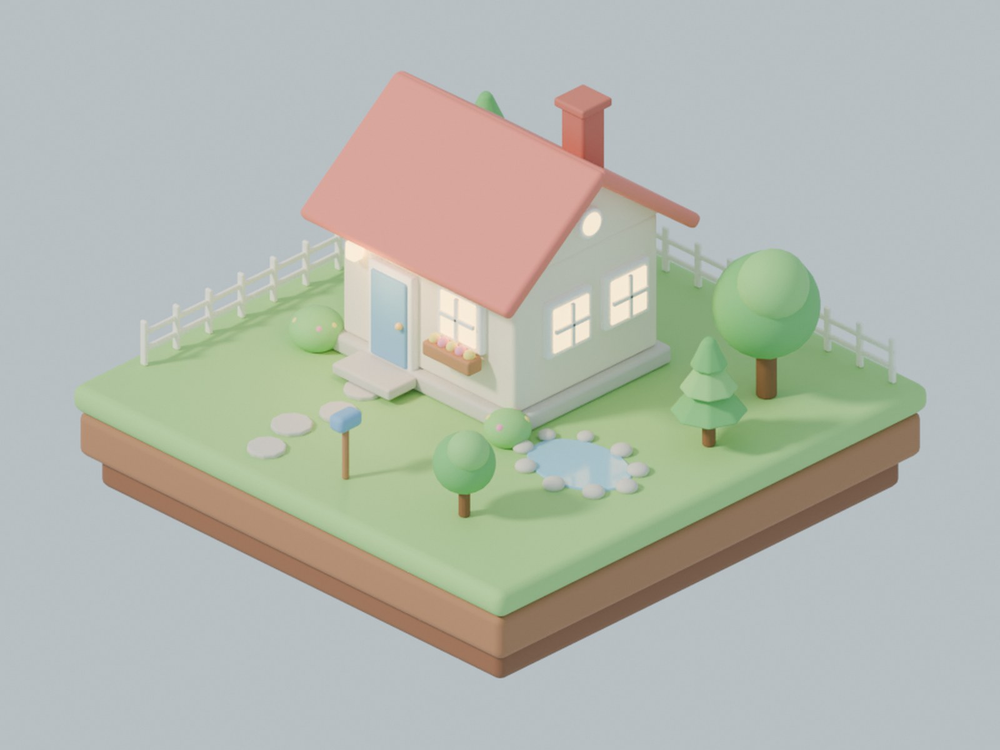
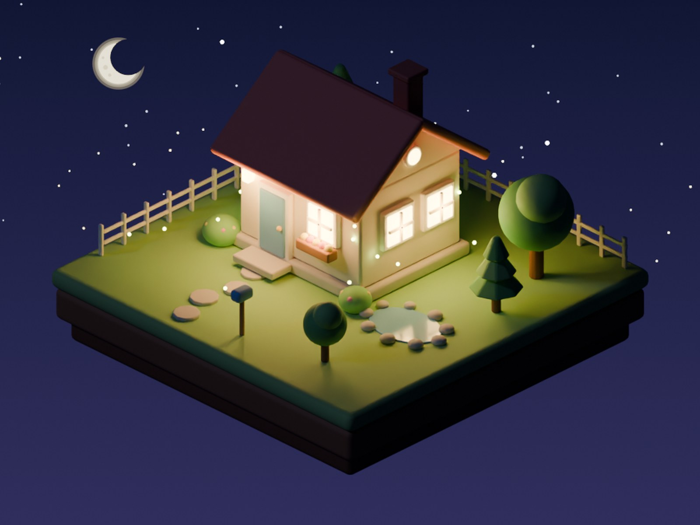
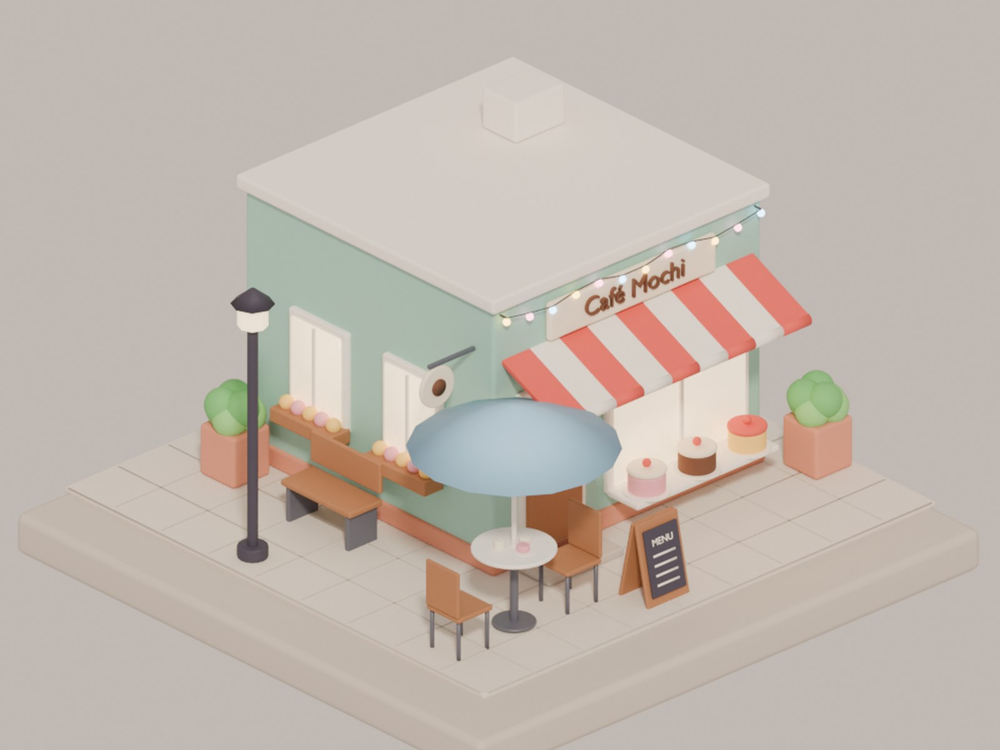
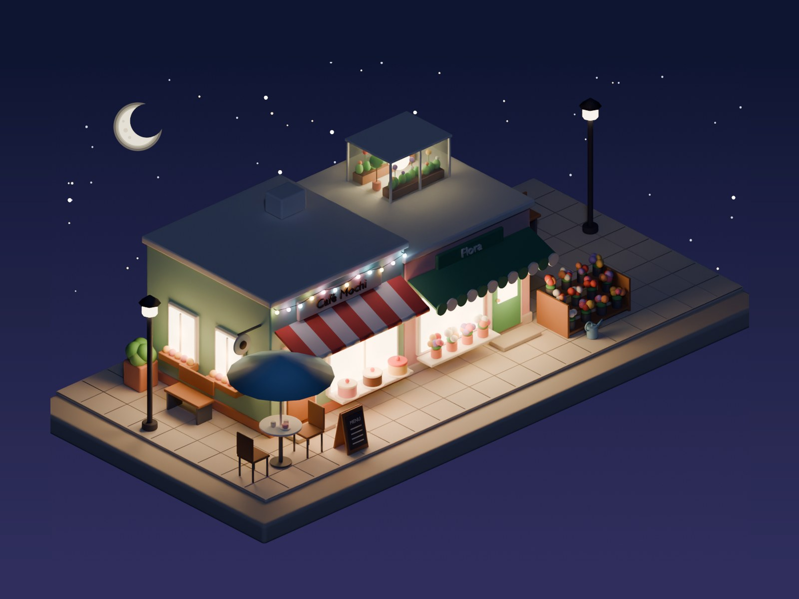
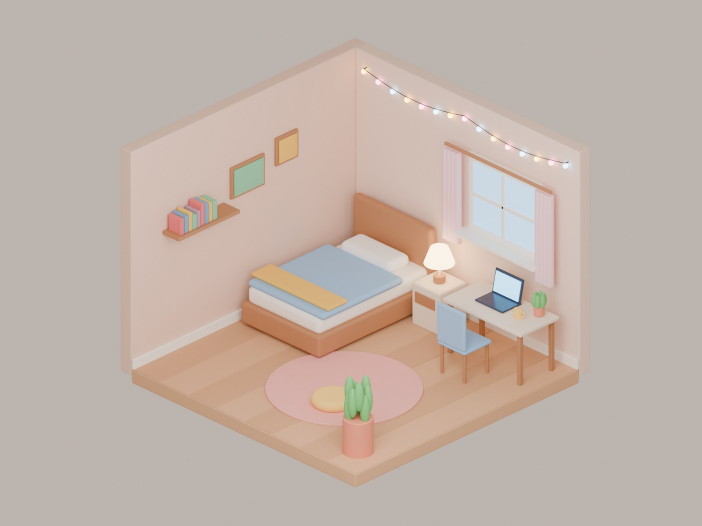

# blender-qa

Automatic and visual QA for Blender scenes built with Python (`bpy`), plus a Claude Code skill
that makes "check everything yourself before showing it" the default.

It came out of building a set of cosy low-poly scenes, where the reviewer kept finding things
like a chair facing the wall, plant leaves floating above their pot, a "sink" that was a flat grey
plate, a staircase you could not get off, and black seams from z-fighting. Every one of those is
written up in **[PITFALLS.md](PITFALLS.md)**, and the tools here catch most of them automatically.

<table>
<tr>
<td></td>
<td></td>
<td></td>
</tr>
<tr>
<td></td>
<td></td>
<td></td>
</tr>
<tr>
<td></td>
<td></td>
<td></td>
</tr>
<tr>
<td></td>
<td></td>
<td></td>
</tr>
<tr>
<td></td>
<td></td>
<td></td>
</tr>
</table>

One theme per row: the island town and the mountain island (day / autumn / night), the cottage (day / winter / night), shops, interiors; night scenes always in the third column. All renders are framed the same way with `python -m blender_qa frame` (same canvas, subject centred at the same scale; `--main-only` ignores clouds around the islands).

## What is in here

```
blender_qa/        the package
  checks.py        core checks: overlap, hidden_inside, keep_clear, floating, zfight, declutter
  geom.py          mesh-accurate geometry (BVH): penetration, containment, surface distance
  rules.py         tag-driven rule packs (interior: seats face their table / desk / screen)
  sweep.py         zoomed multi-angle contact sheets + renders from every scene camera
  review.py        one review.md: camera views, sweep sheets, findings and the visual checklist
  kit.py           building helpers that make the common mistakes impossible
  present.py       frame a set of renders identically (same canvas, same subject scale)
  cli.py           `python -m blender_qa check|sweep|review|frame`
skill/blender-scene-qa/SKILL.md   Claude Code skill: build → check → review → fix → share
PITFALLS.md        everything that went wrong, why, the fix, and which check catches it
examples/          the scene scripts these tools were developed on (island, café street, house...)
tests/             small procedural scenes with known defects (and deliberate non-defects)
```

## Install

Either use Blender's own Python, or the standalone `bpy` module (its Python version must match,
e.g. `bpy` 5.x needs Python 3.13):

```bash
python3.13 -m venv .venv && .venv/bin/pip install bpy
.venv/bin/python tests/test_checks.py        # → ALL CHECKS OK
```

## Use

### Automatic checks — no configuration needed

```bash
python -m blender_qa check scene.blend            # errors listed, warnings counted
python -m blender_qa check scene.blend --warnings --json qa.json
```

| check | catches |
|---|---|
| `overlap` | two features whose surfaces pass through each other, or one sealed inside the other |
| `hidden_inside` | a part completely inside a closed part of the same feature (books in a solid shelf, soil inside a solid pot) |
| `keep_clear` | anything inside a zone that must stay walkable (config zones, or objects tagged `walkway` / `door` / `stairs`) |
| `floating` | parts not (transitively) touching the ground: hovering leaves, bulbs without a wire, a window off a slanted wall |
| `zfight` | coplanar, overlapping, same-facing faces of different materials that are visible → black seams and dots |
| `seat_facing` | (rule pack `interior`) a seat tagged with a front that turns its back on its table / desk / screen |
| `declutter` | (API) removes decor that collides with solids, so scattered shrubs/flowers yield |

How it stays generic:

- **Real geometry.** Bounding boxes are only the broad phase; every finding comes from the actual
  triangles (BVH trees of the evaluated meshes, modifiers, text and curves included). A ring around a
  pole, rotated boards side by side or two spheres touching are not reported; a pole through a board is.
- **Ground is recognised, not named**: anything large and flat (≥ 25% of the scene's width, thin) is
  ground, plus common names (`floor`, `ground`, `terrain`, `water`, `river`, `lake`...).
- **Features are found automatically**: an object's top parent, else a small collection, else the object.
  Loose objects of the same material that interpenetrate are taken as one thing built from primitives.
  Clashes involving loose objects are **warnings** (a deliberate join cannot be told from a collision
  without grouping); only definite problems are **errors** and fail the exit code. Group each feature
  under a parent empty (`kit.item`) or its own collection to make everything definite — and still read
  the warnings: a book through a picture frame was found among them.
- **Names, parents, collections and material names** are all matched, so a material called `cloud`
  is enough to let something fly.
- **Tags override guesses** (custom properties on an object or any parent): `qa_role` =
  `ground | anchor | fly | decor | ignore | walkway | door | stairs | seat | table | desk | screen | tv | counter`,
  `qa_front` = `+x | -x | +y | -y`, `qa_target` = the feature a seat belongs to.
  `kit.item("chair", role="seat", front="+y")` sets them.

Settings go in a `qa.toml` next to the .blend (found automatically, or `--config`); flags override it:

```toml
[check]
ignore = ["rug"]
allow_float = ["lantern"]
packs = ["interior"]
zfight_min_area = 0.0001
keep_clear = [{min = [0.1, 3.3, 0], max = [1.3, 5.5, 2.4], label = "stairs"}]
```

Inside Blender, or from a build script:

```bash
blender -b scene.blend --python-expr \
  "import sys; sys.path.insert(0, '/path/to/blender-qa'); from blender_qa import cli; cli.main(['check', '--current'])"
```

```python
from blender_qa import checks
issues = checks.run_all(bpy.context.scene, bpy.context.evaluated_depsgraph_get(), packs=("interior",))
errors = [i for i in issues if i["level"] == "error"]
```

### Visual review

```bash
python -m blender_qa review scene.blend --out qa_review
```

Renders the scene through every camera it has (perspective or ortho; Cycles or Eevee — the
samples are lowered on whichever engine is active; without a camera a three-quarter view is made),
sweeps the whole scene in zoomed tiles from two angles, runs the checks, and writes
`qa_review/review.md`: findings, camera views, contact sheets with tile coordinates, and the
checklist (recognisability, orientation, circulation, contact, solids, physical plausibility,
render). Geometry checks cannot see that a sink looks like a mat or a moon has the wrong halo;
this is where you look. `sweep` alone writes only the contact sheets.

### Building helpers

```python
from blender_qa.kit import item, slab, chair, basin, potted_plant, mat
with item("dining_chair", role="seat", front="+y"):
    chair(6.0, -1.35, face="+y", frame=mat("#b07a52"))   # backrest is always behind the sitter
with item("sink"):
    basin(7.42, 3.75, 7.78, 4.3, 0.7, 0.92, mat("#c9ccd3", 0.2), drain=mat("#3d3a4b"))
```

## The Claude Code skill

Copy `skill/blender-scene-qa` into `~/.claude/skills/` (or a project's `.claude/skills/`).
It tells Claude to group and tag the scene, run the checks, produce the review packet and go
through every image with the checklist, fix everything, and only then share — once, not one fix
at a time.

## Examples

`examples/` holds the scripts the tools were built and tested on. Run them from inside that
folder with `bpy`; outputs land next to the scripts.

| script | makes |
|---|---|
| `house.py`, `variants.py` | grass-island cottage; night / winter / turntable variants |
| `nightsky.py` | shared night sky used by every night scene (gradient backdrop, sparse stars, crescent moon) |
| `props.py` | shared props: string lights that hang from a wire with hooks to the wall |
| `room.py` | isometric bedroom |
| `cafe.py`, `street.py`, `street_night.py` | café, café + flower shop street, street at night |
| `island.py`, `island_night.py`, `island_autumn.py` | floating island with mountains, lake, waterfall; night and autumn |
| `autumn.py` | shared autumn look (golden meadow, fallen leaves on open ground only, drifting leaves in open air, pumpkins) |
| `street.py` → `town.py` (+ `extras.py`, `declutter.py`), `town_night.py`, `town_autumn.py` | the big island with the town, villa, windmill, garden |
| `home.py -- ground|upper` | cut-away interior of the villa, with built-in overlap/floating checks |
| `spin.py -- file.blend outdir` | turntable frames |
