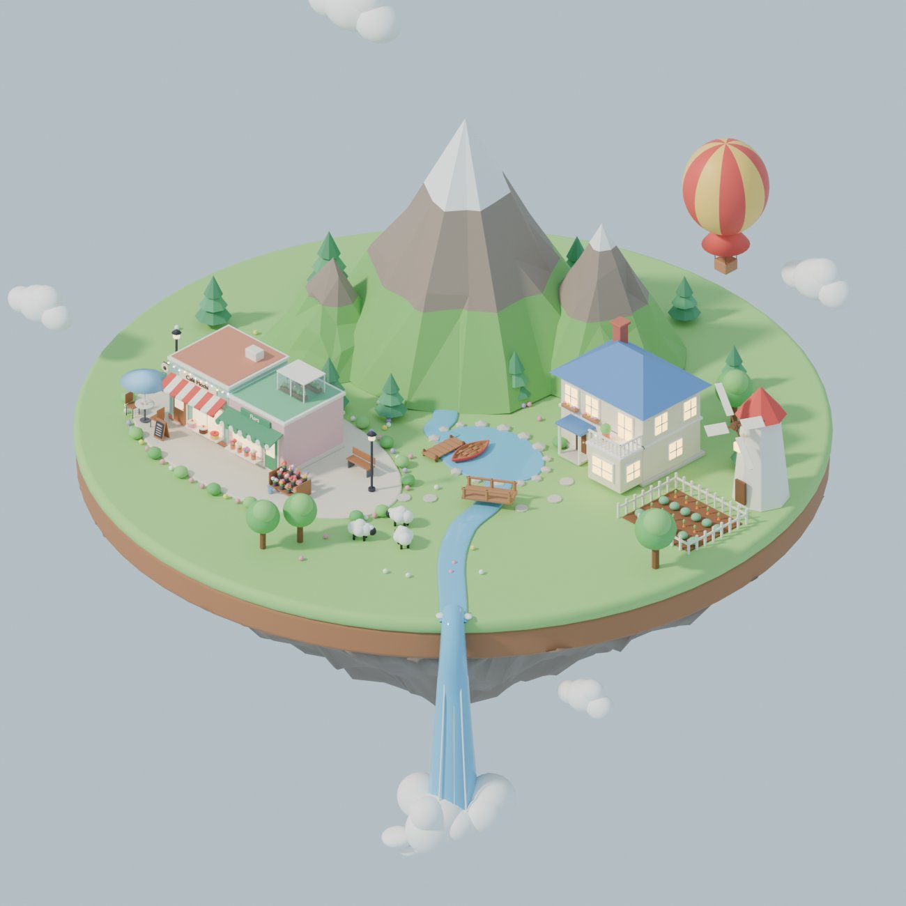
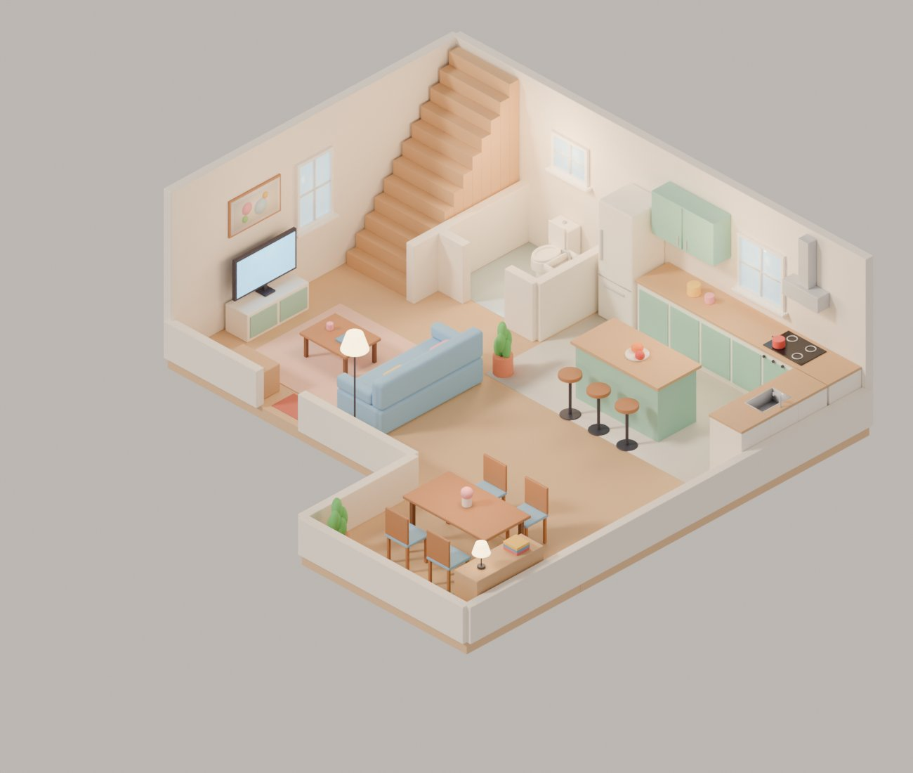
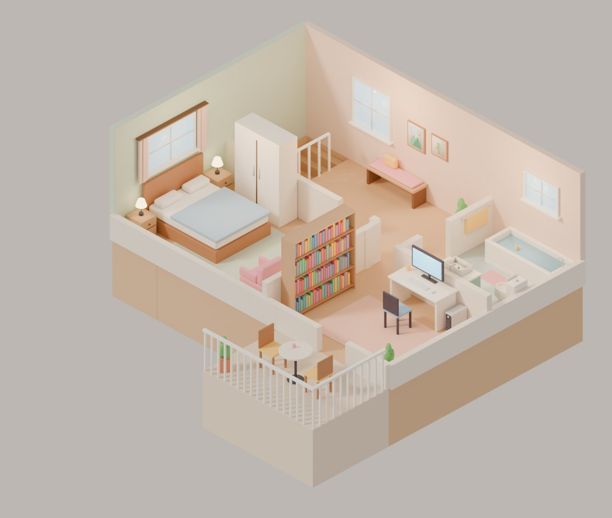
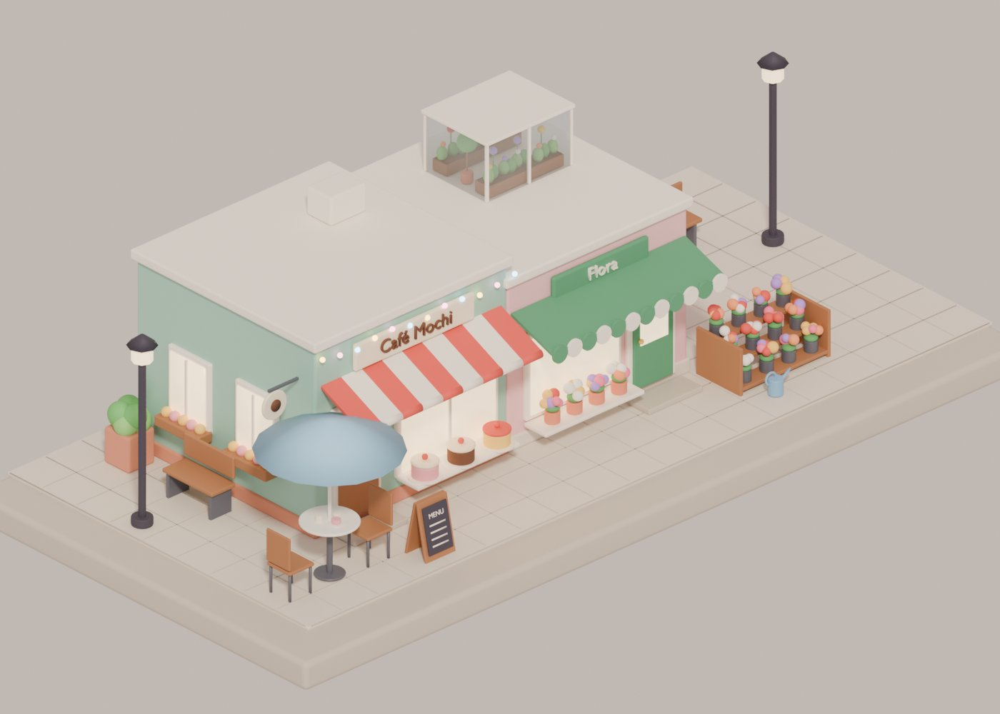

# blender-qa

Automatic and visual QA for Blender scenes built with Python (`bpy`), plus a Claude Code skill
that makes "check everything yourself before showing it" the default.

It came out of building a set of cosy low-poly scenes, where the reviewer kept finding things
like a chair facing the wall, plant leaves floating above their pot, a "sink" that was a flat grey
plate, a staircase you could not get off, and black seams from z-fighting. Every one of those is
written up in **[PITFALLS.md](PITFALLS.md)**, and the tools here catch most of them automatically.

| | |
|---|---|
|  |  |
|  |  |

## What is in here

```
blender_qa/        the package
  checks.py        overlap, hidden_inside, keep_clear, floating, zfight, declutter
  sweep.py         zoomed multi-angle contact sheets of the whole scene
  kit.py           building helpers that make the common mistakes impossible
  cli.py           `python -m blender_qa check|sweep`
skill/blender-scene-qa/SKILL.md   Claude Code skill: build → check → sweep → fix → share
PITFALLS.md        everything that went wrong, why, the fix, and which check catches it
examples/          the scene scripts these tools were developed on (island, café street, house...)
tests/             a tiny scene with one known defect per check
```

## Install

Either use Blender's own Python, or the standalone `bpy` module (its Python version must match,
e.g. `bpy` 5.x needs Python 3.13):

```bash
python3.13 -m venv .venv && .venv/bin/pip install bpy
.venv/bin/python tests/test_checks.py        # → ALL CHECKS OK
```

## Use

### Automatic checks

```bash
python -m blender_qa check scene.blend \
  --ground floor,terrain,lake \      # surfaces things may sit in
  --anchors floor,walls,terrain \    # what everything must ultimately rest on / hang from
  --ignore rug,mat \                 # skipped entirely
  --allow-float cloud,balloon,star \ # meant to fly
  --views front,left \               # only z-fight-test faces visible from these cameras
  --keep-clear "0.1,3.3,0,1.3,5.5,2.4:stairs" \
  --json qa.json
```

Output is one line per issue plus a summary; the exit code is 1 when anything is found.

| check | catches |
|---|---|
| `overlap` | two features interpenetrating |
| `hidden_inside` | a part completely inside a *solid box* of the same feature (books in a solid shelf) |
| `keep_clear` | anything inside a zone that must stay walkable |
| `floating` | parts not (transitively) touching an anchor |
| `zfight` | coplanar, overlapping, same-facing faces that are not pressed against something |
| `declutter` | (API) removes decor that collides with solids, so scattered shrubs/flowers yield |

All checks use world-space bounding boxes of evaluated objects, grouped into features. **Group your
scene**: put each piece of furniture/prop under its own parent empty (`kit.item`), or use
`--group-by collection`. Diagonal and curved shapes can still produce false positives — read the
report rather than trusting it blindly.

Inside Blender:

```bash
blender -b scene.blend --python-expr \
  "import sys; sys.path.insert(0, '/path/to/blender-qa'); from blender_qa import cli; cli.main(['check', '--current', '--ground', 'floor'])"
```

or from a build script:

```python
from blender_qa import checks
dg = bpy.context.evaluated_depsgraph_get()
issues = checks.run_all(bpy.context.scene, dg, ground=("floor",), anchors=("floor", "walls"), views=("front", "left"))
```

### Visual sweep

```bash
python -m blender_qa sweep scene.blend --out qa_sweep --views front,left --tile 2.5
```

Writes `qa_sweep/sweep_front.png` and `sweep_left.png`: the scene cut into zoomed tiles
(rows back → front, columns left → right). Automatic checks cannot tell you that something
does not *look like* what it is — this is where you find that.

### Building helpers

```python
from blender_qa.kit import item, slab, chair, basin, potted_plant, mat
with item("dining_chair"):
    chair(6.0, -1.35, face="+y", frame=mat("#b07a52"))   # backrest is always behind the sitter
with item("sink"):
    basin(7.42, 3.75, 7.78, 4.3, 0.7, 0.92, mat("#c9ccd3", 0.2), drain=mat("#3d3a4b"))
```

## The Claude Code skill

Copy `skill/blender-scene-qa` into `~/.claude/skills/` (or a project's `.claude/skills/`).
It tells Claude to group the scene, run the checks, sweep from two angles, go through a
recognisability / orientation / circulation / contact / solids / render checklist, fix
everything, and only then share — once, not one fix at a time.

## Examples

`examples/` holds the scripts the tools were built and tested on. Run them from inside that
folder with `bpy`; outputs land next to the scripts.

| script | makes |
|---|---|
| `house.py`, `variants.py` | grass-island cottage; night / winter / turntable variants |
| `room.py` | isometric bedroom |
| `cafe.py`, `street.py`, `street_night.py` | café, café + flower shop street, street at night |
| `island.py`, `island_autumn.py` | floating island with mountains, lake, waterfall |
| `street.py` → `town.py` (+ `extras.py`, `declutter.py`), `town_night.py` | the big island with the town, villa, windmill, garden |
| `home.py -- ground|upper` | cut-away interior of the villa, with built-in overlap/floating checks |
| `spin.py -- file.blend outdir` | turntable frames |
| `cow_cat.py` | the cartoon cat that started it all (see PITFALLS 1.16) |
